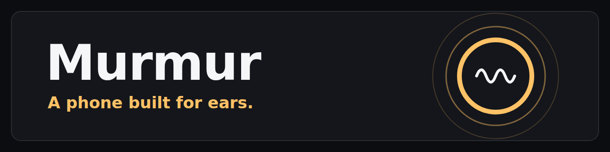
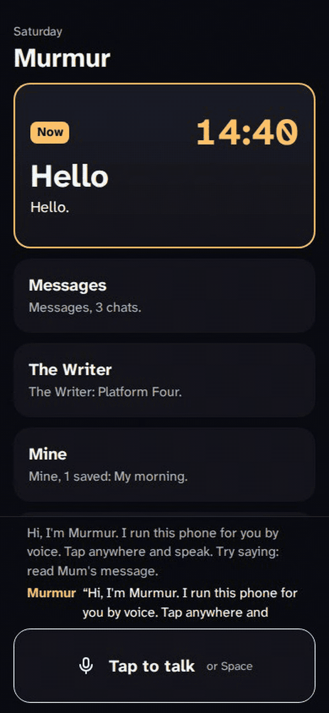
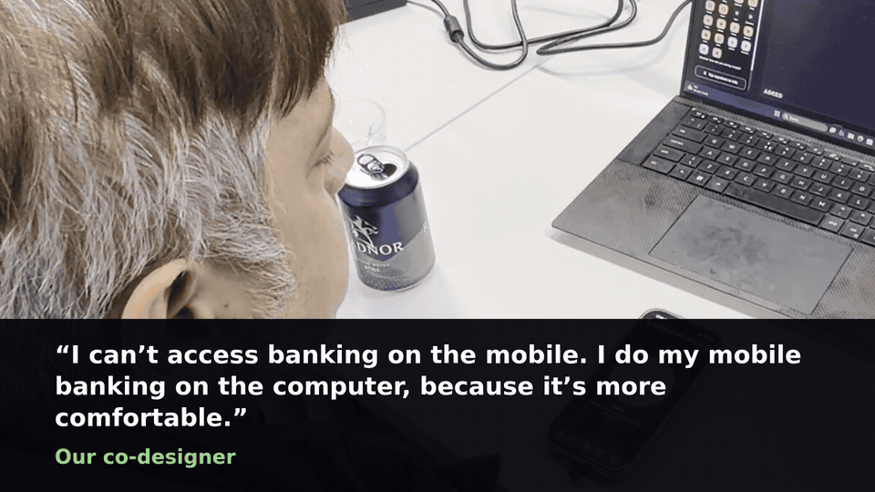
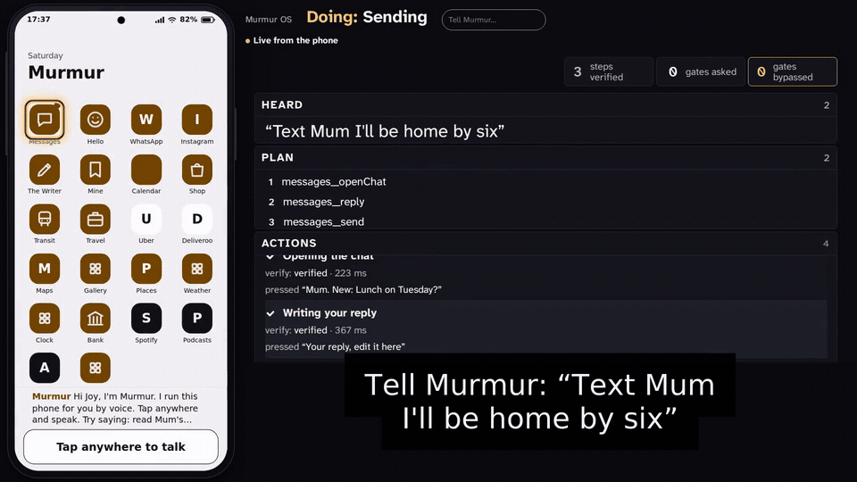
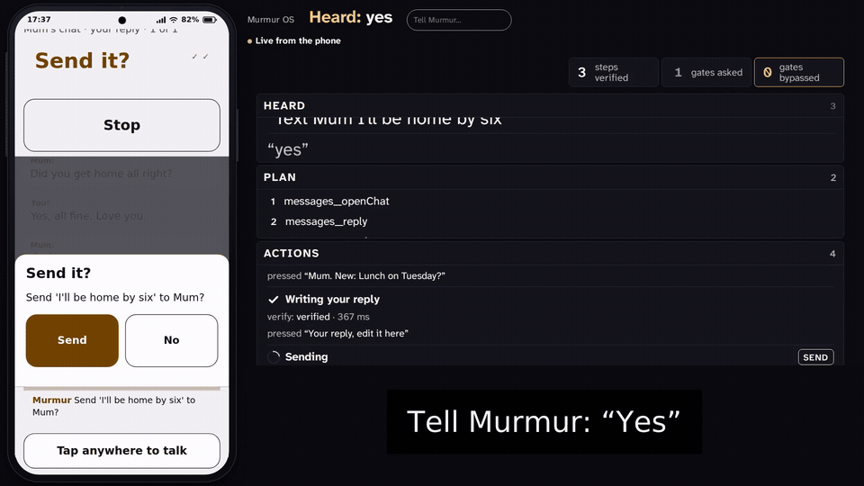
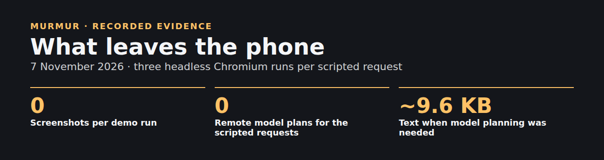
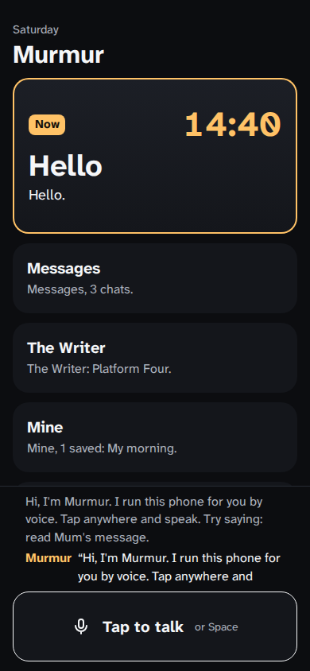
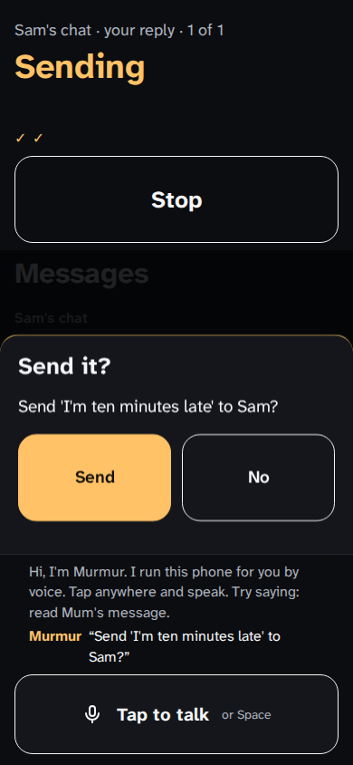
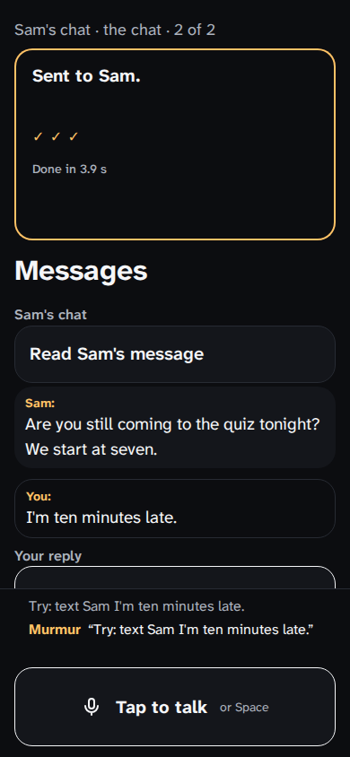

# Murmur

[](package.json)
[](test/)
[](#installation)

For blind and partly sighted phone users, screen readers and magnification can turn a simple task into a sequence of small interactions. One of our two co-designers worked at 400% zoom, where only a portion of an app fits on screen at a time.

Murmur gives each app named actions with results the phone can check. Say what you want, review what will happen, and hear what actually worked. The recorded demo tasks sent **zero screenshots off the phone** across three Chromium runs per task. [Measurement method](scripts/numbers.mjs) · [Original results](https://github.com/atiladeokegab/murmur/blob/ba1c09a062f9e3e9b11204c2070ad689ce778f63/README.md#why-not-computer-use)

Built in one day with two co-designers. Murmur placed **first** at AI Agents for Accessibility, UCL East, London, on 7 November 2026. It runs as a browser-based phone with simulated people, messages, payments and bookings. The accessibility feedback came from co-design sessions.

**[Run the interactive demo](#installation)** · **[Watch the demo film](public/demo.mp4)**



<sub>The real browser app using its offline demo provider. Sending changes the simulated chat.</sub>

## How it works

1. **Name the action.** Say or type a request. The planner uses the apps' own action names and validates arguments against their schemas before the phone moves (`public/agent/plan.js`).

   

2. **Read back the action before it goes out.** Murmur reads the selected recipient and the complete message. Sending, paying, calling and deleting require confirmation, and paying also requires a passkey (`public/os/gate.js`).

   

3. **Check the result in the app.** The runner presses the visible controls and asks the app to verify each action. The work panel ticks a step after the app confirms it and reports where execution stopped if verification fails (`public/agent/runner.js`, `public/apps/messages/index.js`).

   

## Results



The 7 November 2026 checks watched network traffic on main and the live app in headless Chromium, with three runs per line. Acknowledgement timing begins after the transcript reaches the phone. [Original measurements](https://github.com/atiladeokegab/murmur/blob/ba1c09a062f9e3e9b11204c2070ad689ce778f63/README.md#why-not-computer-use)

| Recorded check | Result |
| --- | --- |
| Screenshots sent off the phone | **MEASURED** · 0 per run |
| Remote model plans for the four scripted demo requests | **MEASURED** · 0 |
| Request when model planning is needed | **MEASURED** · one text request of about 9.6 KB |
| Transcript received to “On it” | **MEASURED** · 1–6 ms |

| Phone board | Exact readback | Verified send |
| --- | --- | --- |
|  |  |  |

## Installation

You need Git and Node.js 24 or later. The offline demo provider needs no model API key.

```sh
git clone https://github.com/atiladeokegab/murmur.git
cd murmur
npm ci     # Install the pinned dependencies
npm test   # Run the unit suite
npm start  # Serve the demo at http://localhost:8080
```

## Documentation

The [app contract](os/contract.md) covers named actions, state and verification. To connect a local MCP client, register `node mcp/server.js` with `MURMUR_URL=http://127.0.0.1:8080` and pass the phone's room when calling a tool. [MCP walkthrough](scripts/mcp-demo.mjs)

## Contact

Open an [issue](https://github.com/atiladeokegab/murmur/issues) for bugs or questions. Atilade Oke ([GitHub](https://github.com/atiladeokegab), [LinkedIn](https://www.linkedin.com/in/atiladeoke/)).

## Contributing

Run `npm test` and try the affected flow with keyboard or speech before opening a pull request.

## Citation

```bibtex
@software{murmur_2026,
  title = {Murmur},
  year = {2026},
  url = {https://github.com/atiladeokegab/murmur}
}
```

## License

Contact the maintainers for terms on the project code. The [bundled fonts](public/fonts/LICENSE.txt) and [toolkit](public/vendor/toolkit/LICENSE) carry their own terms.
