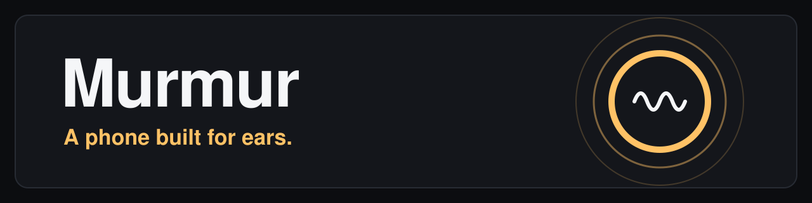
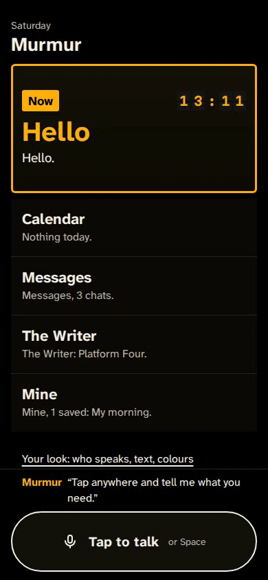
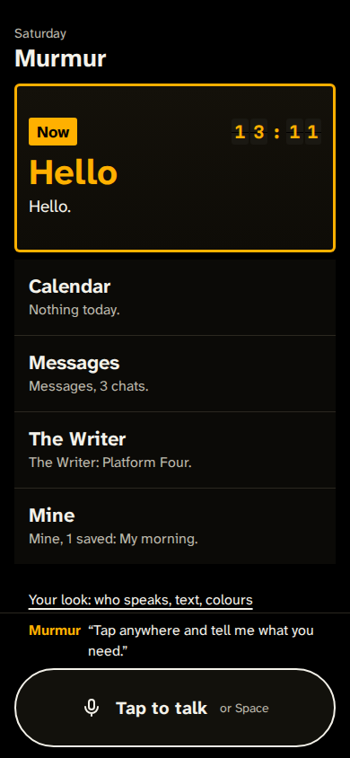
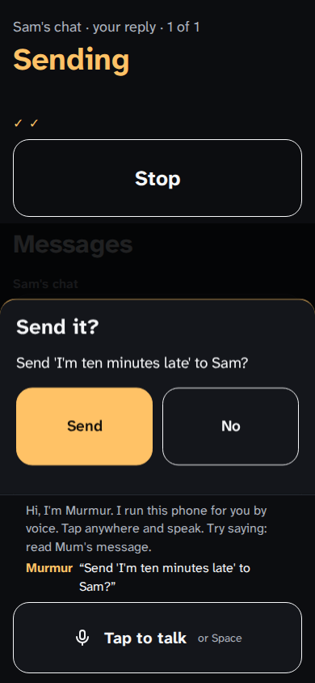
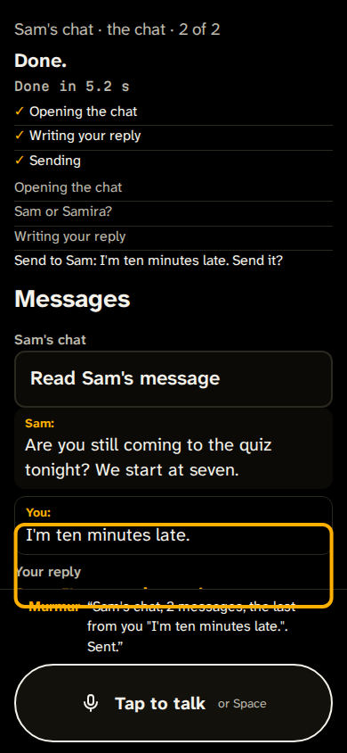
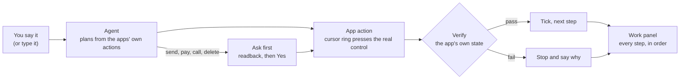

<p align="center">
  
</p>

<p align="center">
  
  
  
  
  
  
  
</p>

<p align="center"><b>Screen readers translate a phone built for eyes. Murmur is a phone built for ears.</b></p>

<p align="center">
  <a href="https://murmur-901257379404.europe-west1.run.app"><b>Live app</b></a> ·
  Demo film (coming) ·
  Deck (coming)
</p>

<p align="center">
  
</p>
<p align="center"><sub>Vertical 1, real screens, demo provider: <i>"Text Sam I'm ten minutes late."</i></sub></p>

---

## The problem

A phone is a picture. A screen reader is a narrator hired to describe that picture one rectangle at a time,
in whatever order the painter left them. What a sighted person gets in one glance (where am I, what can I do
here, what just changed) a blind person has to rebuild from a stream of labels. And when the painter forgot a
label, the narrator goes quiet.

That is why *"most apps just don't follow the guidelines"* is a complaint that never goes away. Accessibility
gets bolted on after the picture is painted, and a bolt can always be left off.

Murmur starts from the other end. Its smallest part is not a pixel or a widget. It is a **named action with
a state you can check**. Every app says what it can do, what it shows now, and how to prove an action
worked. A tap, a spoken sentence and the agent's own hands all go through that one door. Nothing can be
unlabelled, the agent can't invent a button that doesn't exist, and no step gets a tick until the app
confirms it.

We designed it today with two people: one who is partly sighted and reads at 400% zoom, and one who is
blind and uses a screen reader every day. They asked for *"a lot of agency"*, so Murmur offers, and you
decide.

## Who it's for

- **Blind people** who already live in a screen reader and want to say what they need, not swipe through
  forty labels to get there.
- **Partly sighted people** at high zoom, who see one corner of a screen at a time and lose their place.
- **Anyone who would rather talk than look**: Murmur runs eyes-free, and it shows its work for the people
  who can see it.

## What it does

| | |
|---|---|
| **You talk, it drives** | Say it, and Murmur works the app in front of you. An amber cursor ring lands on each control it presses, the same buttons you would press. |
| **Every step is checked** | After each action the app itself confirms the result before the step gets a tick. If it didn't work, Murmur says so in plain words and stops. |
| **Asks first** | Send, pay, call and delete never just happen. A sheet reads back exactly what will leave the phone, and waits for your Yes. Pay also needs your fingerprint (a passkey). |
| **Routines by voice** | Do something once, then say *"save that as my morning"*. It becomes a tile on your board. |
| **Teaches "how do I"** | Ask *"how do I…"* and Murmur speaks the steps in the app's own words, then offers to do it or walk you through it until you can do it alone. |
| **Shows its work** | The work panel names each step as it happens and ticks it when the app confirms it. |
| **Your look** | Text up to 400% that reflows instead of scrolling sideways; dark, light or yellow-on-black colours; large targets. |

<p align="center">
  
  &nbsp;
  
  &nbsp;
  
</p>
<p align="center"><sub>The board · ask first, with the readback · sent, every step ticked</sub></p>

## Why not computer use?

Computer use clicks pixels it reads from screenshots, which suits a sighted supervisor who can watch it and
catch its mistakes. In Murmur each app declares its actions: the OS gates send, pay, call and delete behind
an ask (pay also needs a fingerprint), every step is checked against the app's own state, and words Murmur
already knows are planned on the phone and never leave it. The closest prior
work is Apple's App Intents and Android's App Actions; Murmur makes that kind of declared action the only way
an app can be driven, by a person or the agent.

## How it works



1. **Hear.** Gemini Live listens when a key is set; the browser's Web Speech is the fallback; you can always
   type instead. A few reserved words (*stop*, *where am I*, *carry on*) are handled before anything else.
2. **Plan.** The utterance goes to Gemini with the registry of every app's actions as its tools. The plan
   that comes back is checked against each action's schema; anything unknown is dropped and said out loud.
   With no key, a deterministic demo provider produces the same kind of plan offline.
3. **Act.** One action at a time. The agent moves the visible cursor ring to the real control, names it,
   and presses it. It never reaches into an app's state behind the screen.
4. **Verify.** The app's own `verify` decides whether the step worked. A tick means the app agreed.
5. **Ask first.** An action marked `send`, `pay`, `call` or `delete` stops the run and opens the ask-first
   sheet, filled from the app's state rather than from the model's memory.
6. **Show.** Every step goes onto one event bus, so the work panel, the memory and the tests all read the same
   record.

Every app is one ES module that exports one object: `mount`, `read`, `place`, `state`, and a set of
`actions`, each with `run`, `verify` and an optional `gate`. The contract is in [`os/contract.md`](os/contract.md).

## Run locally

Needs Node 24 or later. There are no npm dependencies, so there is nothing to install.

```bash
npm start                         # http://localhost:8080, demo provider, no key needed
PORT=3000 npm start               # any free port
GEMINI_API_KEY=... npm start      # Gemini plans, Live voice and speech
npm test                          # the unit tests
```

With no `GEMINI_API_KEY`, Murmur runs fully offline on the demo provider. To try Vertical 1, open the app,
tap **Tap to talk** (or press Space) and say *"Text Sam I'm ten minutes late"*.

To regenerate the images in this README from the real app:

```bash
PLAYWRIGHT=<path to the playwright package> node docs/readme/capture.mjs   # needs ffmpeg
```

## Known limitations

- **The apps are simulated.** Messages, Calendar, The Writer and Mine run inside Murmur with invented
  people. Nothing is actually sent, paid or called.
- **It is a web app, not a phone OS yet.** Murmur runs in the browser as a simulated phone. It is not an
  Android accessibility service, and it cannot drive other apps on a real phone.
- **The numbers are still being measured.** Task time, steps per task and accuracy on our eval set:
  measuring. We won't quote a figure until it has a source.
- **Voice-owner detection is not built.** The fingerprint guards pay; recognising the owner's voice is next.
- **Built in one day**, with two co-designers. That is two people, not a study.

## What we'd build next

1. **An Android accessibility service.** The same agent, gates and verify loop, driving the real phone
   through Android's accessibility APIs, so the cursor ring presses real buttons in real apps.
2. **Real apps.** Messages, calls and calendar on the phone's own accounts, each behind the same ask-first
   sheet and the same readback.
3. **Proper measurement.** Task time and accuracy against a screen reader on the same tasks, with blind and
   partly sighted testers.
4. **Owner's voice and place triggers.** Spend and send only for the owner's voice; routines that offer
   themselves when you arrive somewhere.
